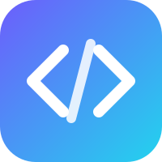
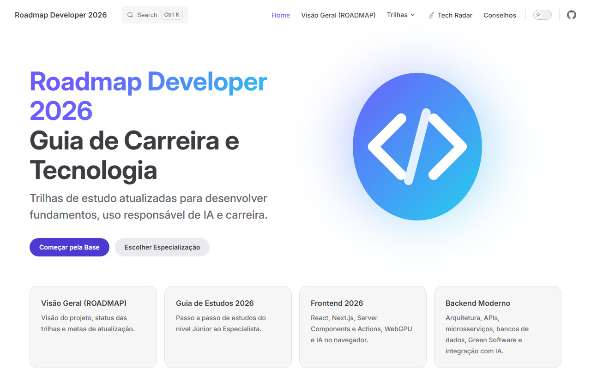
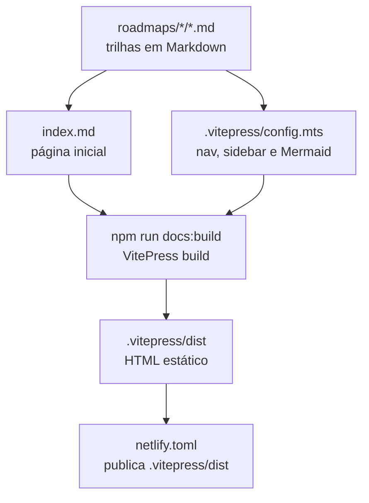

<div align="center">



# Roadmap Developer 2026

<h3>O Guia Definitivo para sua Carreira na Era da IA</h3>

<p>Trilhas de estudo completas, desde o nível Júnior até Especialista, transformadas em um site estático moderno com VitePress.</p>

<a href="https://github.com/juninmd/roadmap-developer/actions/workflows/validate.yml"></a>
<a href="https://github.com/juninmd/roadmap-developer/blob/master/LICENSE"></a>


<br><br>



</div>

> **Trilhas de estudo para desenvolvedores, do Júnior ao Especialista, em um site estático em português.** Para rodar localmente: `npm install && npm run docs:dev`.

---

## 🗺️ O Que Você Vai Encontrar

Este projeto foi atualizado para refletir o mercado de tecnologia em **2026**, focando não apenas em código, mas em Inteligência Artificial, Sustentabilidade e Arquitetura Moderna.

- [**Trilha Comum (Base)**](./roadmaps/general/common.md): Git, IA Literacy, Prompt Engineering e Lógica.
- [**Backend**](./roadmaps/backend/backend.md): Microsserviços, IA Engineering (RAG, Agents), Green Software e Observabilidade.
- [**Frontend**](./roadmaps/frontend/frontend.md): Generative UI, Server Actions, WebGPU e Acessibilidade.
- [**Full Stack**](./roadmaps/fullstack/fullstack.md): Server Components, Monorepos, Integração de IA e Arquitetura de Sistemas.
- [**Mobile**](./roadmaps/mobile/mobile.md): On-Device AI (ExecuTorch), Kotlin Multiplatform e Superapps.
- [**Inteligência Artificial**](./roadmaps/ai/artificial-intelligence.md): Agentes Autônomos, LLMOps, Fine-Tuning e Sistemas Compostos.
- [**DevOps & Platform**](./roadmaps/devops/devops.md): Platform Engineering, FinOps e GitOps.
- [**Engenharia de Dados**](./roadmaps/data/data-engineering.md): Lakehouse, Streaming e Governança.
- [**Cybersecurity**](./roadmaps/security/cybersecurity.md): Zero Trust, DevSecOps e Segurança de IA.

## 🚀 Rodando Localmente

Para rodar o site de documentação na sua máquina (Node.js 20.19 ou superior):

1.  **Clone o repositório e instale as dependências:**

    ```bash
    git clone https://github.com/juninmd/roadmap-developer.git   # clona o repositório
    cd roadmap-developer                                          # entra na pasta do projeto
    npm install                                                   # instala as dependências do package.json
    ```

2.  **Verifique a qualidade e testes:**

    ```bash
    npm run lint             # ESLint sobre o projeto
    npm run test:coverage    # Vitest com relatório de cobertura
    npm run test:e2e         # Playwright (na primeira vez: npx playwright install)
    ```

3.  **Inicie o servidor de desenvolvimento:**

    ```bash
    npm run docs:dev         # VitePress em modo de desenvolvimento
    ```

    O site estará disponível em `http://localhost:5173`.

4.  **Gere a versão de produção:**

    ```bash
    npm run docs:build       # gera o site estático em .vitepress/dist
    npm run docs:preview     # serve o build gerado em http://localhost:4173
    ```

## ⚙️ Como Funciona

Cada trilha é um arquivo Markdown em `roadmaps/`. O VitePress lê esses arquivos, aplica a navegação e a barra lateral definidas em `.vitepress/config.mts` e gera HTML estático.



- **Sem servidor de aplicação:** o resultado do build são arquivos estáticos; não há banco de dados nem API em execução.
- **Diagramas Mermaid** são renderizados no build pelo `vitepress-plugin-mermaid`, configurado em `.vitepress/config.mts`.

## 📦 Deploy

O arquivo `netlify.toml` define o build (`npm ci && npm run docs:build`), a versão do Node (20) e a pasta publicada (`.vitepress/dist`).

Não há workflow de deploy em `.github/workflows/`. A publicação depende de o repositório estar conectado a um site no Netlify, configuração que não é verificável a partir deste código.

Para publicar sua própria cópia, conecte o repositório a um site no Netlify; o `netlify.toml` já configura o build.

## 🤝 Contribuição

Quer sugerir um novo tópico ou corrigir algo?
Leia nosso [Guia de Contribuição](./CONTRIBUTING.md) para saber como ajudar.

## ⚠️ Limitações Conhecidas

- Requer Node.js 20.19 ou superior (`engines` em `package.json`).
- O teste E2E roda em Chromium, Firefox e WebKit. Sem os navegadores do Playwright instalados (`npx playwright install`), os projetos Firefox e WebKit falham.
- O repositório não traz workflow de deploy; ver [Deploy](#-deploy).

## 📄 Licença

Este projeto está licenciado sob a Licença MIT - veja o arquivo [LICENSE](./LICENSE) para detalhes.

---

_Inspirado pelo trabalho incrível da comunidade open source e projetos como roadmap.sh._
